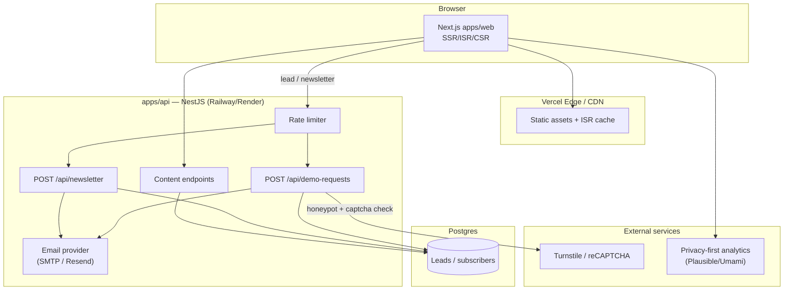

# ARCHITECTURE — Prime Agentic Website

Defines the system architecture for the showcase + lead-generation site:
monorepo layout, frontend/backend split, data flow, and deployment.

---

## 1. Overview

A pnpm + Turborepo monorepo with:

- **`apps/web`** — Next.js (App Router), TypeScript strict, Tailwind, shadcn/ui,
  Framer Motion, Embla Carousel.
- **`apps/api`** — NestJS: contact/demo-request, newsletter, content, email,
  rate limiting.
- **`packages/ui`** — shared components (`Carousel`, `Hero`, `PlatformCard`,
  `DemoViewer`).
- **`services/ai-demo`** — optional Python/FastAPI, only if explicitly requested.



---

## 2. Monorepo Layout

```
prime-agentic/
├── apps/
│   ├── web/                 # Next.js (App Router)
│   └── api/                 # NestJS
├── packages/
│   └── ui/                  # shared React components
├── services/
│   └── ai-demo/             # (optional) Python/FastAPI
├── docs/                    # this documentation
├── package.json             # pnpm workspaces + Turborepo
├── turbo.json
├── pnpm-workspace.yaml
├── .env.example
└── .github/workflows/       # CI
```

Tooling: ESLint, Prettier, TypeScript strict, Husky + lint-staged, Vitest
(unit), Playwright (e2e + a11y), GitHub Actions CI.

---

## 3. Frontend — `apps/web`

- **Framework:** Next.js App Router, React Server Components by default.
- **Styling:** Tailwind with design tokens from `SITEMAP_UIUX.md`; shadcn/ui
  primitives.
- **Rendering strategy:**
  - Public pages (home, platform pages, about, contact): **SSR** for SEO.
  - Blog: **ISR** with revalidation.
  - Interactive pieces (carousels, `DemoViewer`, `AgentFlow`): client components.
- **Data:** all demos read mock JSON from `apps/web/mocks/*.json`; no live
  platform data.
- **Forms:** call `apps/api` via a typed client (`fetch` wrapper with
  `zod`-validated responses).
- **SEO:** per-page metadata, OpenGraph images, `sitemap.xml`, `robots.txt`,
  JSON-LD.

### Key page components

| Component                                                            | Source        |
| -------------------------------------------------------------------- | ------------- |
| `Carousel`, `Hero`, `PlatformCard`, `DemoViewer`                     | `packages/ui` |
| `AgentFlow`, `Header`, `Footer`, `LeadForm`, `NewsletterForm`, `FAQ` | `apps/web`    |

---

## 4. Backend — `apps/api` (NestJS)

Modules (each a Nest module):

| Module        | Endpoint(s)               | Notes                                                     |
| ------------- | ------------------------- | --------------------------------------------------------- |
| Demo requests | `POST /api/demo-requests` | DTO validation, rate limit, honeypot, captcha hook, email |
| Newsletter    | `POST /api/newsletter`    | Email validation, rate limit, opt-in flag                 |
| Content       | `GET /api/content/*`      | Optional; content is primarily static MDX in-repo         |
| Email         | internal provider         | Interface with SMTP / Resend implementations              |

**Request pipeline for lead capture:**

1. Global rate limiter (e.g. `@nestjs/throttler`) — per-IP and per-form.
2. `class-validator` DTO validation.
3. Honeypot field check (hidden field must be empty).
4. Captcha verification hook (Turnstile or reCAPTCHA) — provider interface so
   it can be swapped or disabled in dev.
5. Persist lead to Postgres via Prisma.
6. Send email notification via the email provider interface.

**Persistence:** Prisma ORM + Postgres. Migrations committed to the repo.

---

## 5. Shared — `packages/ui`

- Framework-agnostic, TypeScript-typed React components consumed by `apps/web`.
- Own Vitest unit tests and Storybook stories (Carousel etc.).
- No runtime dependency on the app; styled via Tailwind tokens.

---

## 6. Deployment

| Concern          | Target                  | Notes                                      |
| ---------------- | ----------------------- | ------------------------------------------ |
| Web (`apps/web`) | **Vercel**              | Edge CDN, ISR, preview deploys per PR      |
| API (`apps/api`) | **Railway / Render**    | Containerized NestJS, Postgres add-on      |
| Database         | Postgres (managed)      | Railway/Render managed Postgres            |
| Email            | Resend (default) / SMTP | Configured via env, never committed        |
| Analytics        | Plausible / Umami       | Privacy-first; GA4 optional behind consent |

**Environments:**

| Env          | Purpose                                                |
| ------------ | ------------------------------------------------------ |
| `local`      | `.env` from `.env.example`; SQLite/Postgres via Docker |
| `preview`    | Vercel preview + staging API                           |
| `production` | `prime-agentic.com`                                    |

**Secrets:** only via env vars; `.env.example` documents keys with no values.
Never commit real keys.

---

## 7. CI/CD (GitHub Actions)

- **On PR:** install → lint → typecheck → unit tests (Vitest) → build → e2e/a11y
  (Playwright).
- **On merge to `main`:** deploy web (Vercel) and API (Railway/Render).

---

## 8. Cross-cutting concerns

- **Security:** rate limiting, honeypot, captcha, input validation, no secrets
  in repo, HTTPS everywhere, sensible CORS allow-list.
- **Performance:** target LCP < 2.5s, CLS < 0.1, INP < 200ms (see
  `SITEMAP_UIUX.md`).
- **Accessibility:** WCAG 2.2 AA, reduced-motion support.
- **Observability:** structured logs from API; analytics on web.
