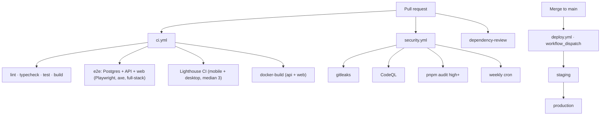

# OBSERVABILITY & CI/CD — Prime Agentic Website

Continuous integration, security scanning, observability, and the (still
host-agnostic) deploy path. Complements `TECH_WORKFLOW.md` and
`ARCHITECTURE.md`.

---

## 1. Pipeline

- `ci.yml` runs on every PR and push to `main` (cancels superseded runs).
- `security.yml` runs on PR, push to `main`, and weekly.
- `deploy.yml` is **manual only** (`workflow_dispatch`) and targets a GitHub
  Environment per target.

---

## 2. Required secrets

**GitHub Actions secrets** (configure in repo → Settings → Secrets and
variables → Actions):

| Secret                                                                       | Used by                             |
| ---------------------------------------------------------------------------- | ----------------------------------- |
| `SENTRY_ORG`, `SENTRY_PROJECT`, `SENTRY_AUTH_TOKEN`                          | source-map upload in `ci.yml` build |
| `STAGING_API_URL`, `STAGING_SITE_URL`, `STAGING_TURNSTILE_SITE_KEY`          | web build-args for staging          |
| `PRODUCTION_API_URL`, `PRODUCTION_SITE_URL`, `PRODUCTION_TURNSTILE_SITE_KEY` | web build-args for production       |

**Runtime env (per environment, injected by the host):**

| Var                                                                              | App                       |
| -------------------------------------------------------------------------------- | ------------------------- |
| `DATABASE_URL`                                                                   | api                       |
| `TURNSTILE_SECRET_KEY`                                                           | api                       |
| `EMAIL_PROVIDER`, `SALES_INBOX_EMAIL`, `EMAIL_FROM`, `RESEND_API_KEY` / `SMTP_*` | api                       |
| `CORS_ORIGIN`, `TRUST_PROXY_HOPS`                                                | api                       |
| `SENTRY_DSN`, `SENTRY_TRACES_SAMPLE_RATE`, `SENTRY_RELEASE`                      | api                       |
| `NEXT_PUBLIC_API_URL`, `NEXT_PUBLIC_SITE_URL`, `NEXT_PUBLIC_TURNSTILE_SITE_KEY`  | web (baked at build time) |
| `NEXT_PUBLIC_SENTRY_DSN`, `NEXT_PUBLIC_SENTRY_TRACES_SAMPLE_RATE`                | web (client)              |

`NEXT_PUBLIC_*` values are baked at **build time**, so the web image is built
per environment with the matching `--build-arg`s (see `deploy.yml`). The API
image is host-agnostic and is built once, then promoted.

---

## 3. Environments

| Env          | Purpose                     | Reviewers                                    |
| ------------ | --------------------------- | -------------------------------------------- |
| `staging`    | Pre-production verification | Required reviewers on the GitHub Environment |
| `production` | Live site                   | Required reviewers on the GitHub Environment |

Configure required reviewers in GitHub → Settings → Environments →
(environment) → Required reviewers. The `deploy.yml` job references the
environment via `environment: ${{ inputs.environment }}`.

---

## 4. Rollback

Redeploy the previous image. Because the image is tagged with the git SHA
(`prime-agentic-{api,web}:<sha>`), rollback is:

1. Find the last-known-good SHA in the registry (or the previous deploy log).
2. Re-run `deploy.yml` (or the host's deploy step) pointed at that image tag.

The host step is still a TODO; once the host is chosen, record the exact
promote/rollback command here.

---

## 5. Uptime monitoring (external)

Point an external uptime monitor (e.g. Better Stack, UptimeRobot, Gatus) at:

- `GET /health` — returns `200 {"status":"ok"}` and checks the DB with
  `SELECT 1`.
- `POST /api/demo-requests` — monitor the contact endpoint with a synthetic
  request that expects `201` (or a graceful `429`/`401`), not a `5xx`.

Alert on non-2xx/3xx, and on the health check failing twice in a row.

---

## 6. Branch protection

Apply these manually in GitHub → Settings → Branches → add rule for `main`:

- **Require a pull request before merging** (no direct pushes to `main`).
- **Require status checks to pass**: `CI / checks`, `CI / e2e`,
  `CI / lighthouse`, `Security / gitleaks`, `Security / codeql`,
  `Security / audit`.
- **Require conversation resolution** and **require review from Codeowners**
  (if a CODEOWNERS file is added later).

---

## 7. Pull-request checklist

- [ ] Conventional commit message, small and reviewable.
- [ ] `pnpm lint`, `pnpm typecheck`, `pnpm test`, `pnpm build` pass locally.
- [ ] New behavior has Vitest and/or Playwright coverage (incl. axe for UI).
- [ ] No secrets committed; `.env.example` updated for any new env var.
- [ ] Demo/data changes keep everything clearly marked illustrative.
- [ ] Sentry `beforeSend` still scrubs new lead fields / headers if the schema
      changes.
